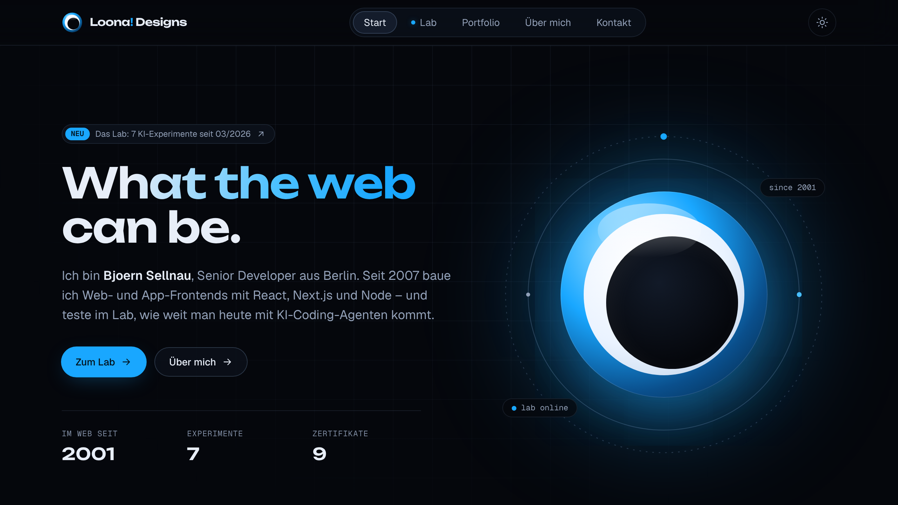
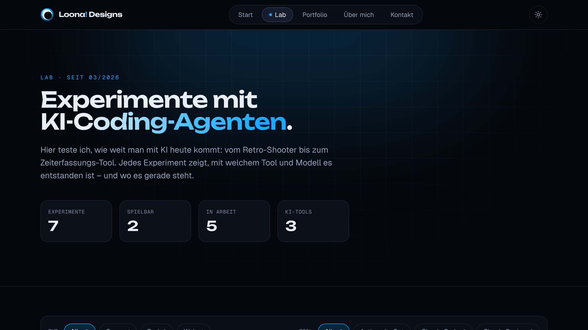

# Loona! Designs – Redesign (Entwurf)

Neuer Entwurf für [loona-designs.de](https://loona-designs.de), das Online-Portfolio von Bjoern Sellnau, mit Next.js 16 und einem neuen Bereich **Lab** für KI-Experimente.

Die Analyse der alten Seite mit allen Befunden und Quellen steht in [`docs/ANALYSE.md`](docs/ANALYSE.md).




## Stack

- Next.js 16.4 (App Router, Turbopack, Cache Components, Partial Prefetching)
- React 19.3 (`<ViewTransition>` für den Morph von der Lab-Karte zur Detailseite)
- TypeScript, Tailwind CSS 4, ESLint 9
- Keine weiteren Runtime-Abhängigkeiten: Icons, Logo und Lab-Cover sind eigenes SVG

## Starten

```bash
npm install
```

```bash
npm run dev
```

Die Seite läuft dann unter http://localhost:3000.

```bash
npm run build && npm run start
```

## Struktur

```
src/
  app/
    page.tsx              Startseite
    lab/page.tsx          Lab – Übersicht mit Filter
    lab/[slug]/page.tsx   Lab – Detailseite je Experiment
    portfolio/            Ausgewählte Projekte + Archiv 2002–2016
    ueber-mich/           Werdegang, Zertifikate, Skills, Werkzeuge
    kontakt/              E-Mail & Profile
    impressum/            § 5 DDG
    datenschutz/          ohne Cookies & Tracking
    not-found.tsx         404-Seite
    opengraph-image.tsx   generiertes Social-Preview-Bild
    sitemap.ts, robots.ts, manifest.ts, icon.svg
  components/             Header, Footer, UI-Bausteine, Lab-Komponenten
  content/                Inhalte als typisierte Daten
    lab.ts                KI-Experimente
    portfolio.ts          Archiv & ausgewählte Arbeiten
    profile.ts            Werdegang, Zertifikate, Skills
    site.ts               Name, URL, E-Mail, Navigation, Social Links
  proxy.ts                echte 404 für unbekannte Lab-Slugs
```

## Neues Lab-Experiment hinzufügen

Einen Eintrag in `src/content/lab.ts` ergänzen:

```ts
{
  slug: "mein-experiment",
  title: "Mein Experiment",
  subtitle: "Kurzbeschreibung",
  date: "2026-11",
  category: "game",          // "game" | "tool" | "web"
  status: "in-arbeit",       // "in-arbeit" | "spielbar" | "abgeschlossen"
  tools: ["Claude Code"],
  models: ["Opus 4.8"],
  summary: "Ein Satz für Karte und Meta-Description.",
  description: ["Absatz 1", "Absatz 2"],
  playUrl: "https://…",      // optional
  hue: 200,                  // Farbton für das generative Cover
}
```

Detailseite, Sitemap-Eintrag, Filter und Zähler entstehen daraus automatisch.

## Weiterleitungen

Die alten URLs werden in `next.config.ts` dauerhaft (308) umgeleitet:

| Alt | Neu |
| --- | --- |
| `/portfolio.htm` | `/portfolio` |
| `/uebermich.htm` | `/ueber-mich` |
| `/impressum.htm` | `/impressum` |
| `/kontakt.htm` | `/kontakt` |
